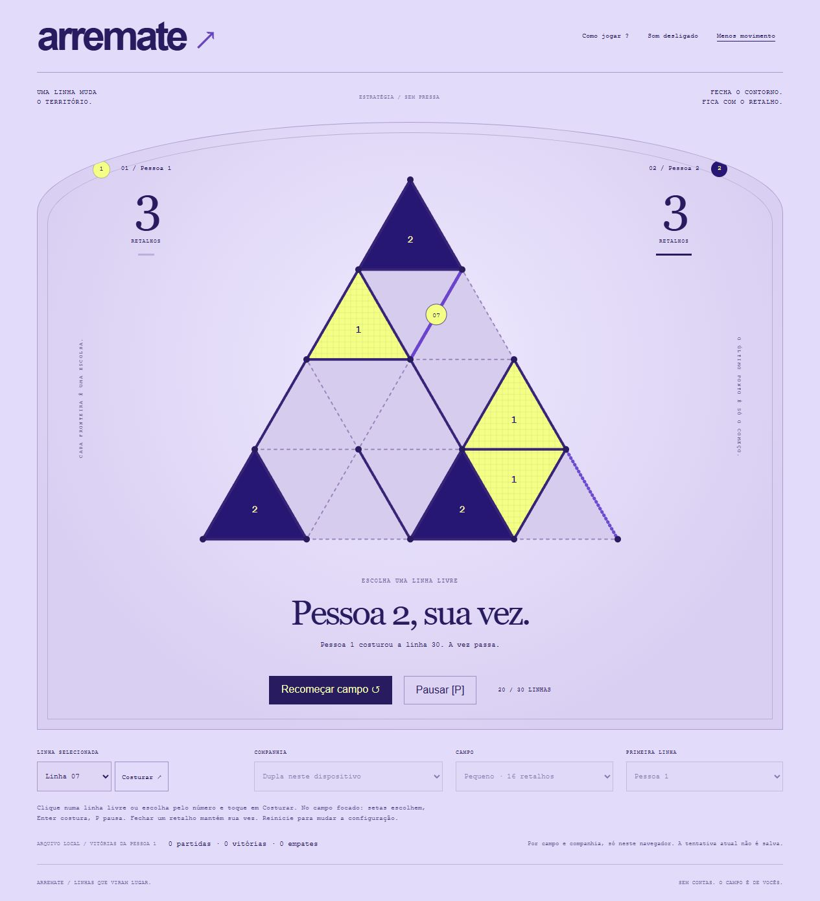

# Arremate

**A última linha muda tudo.**

[Jogar gratuitamente](https://gustapaz.github.io/arremate/)



Estratégia territorial em campo triangular. Costure fronteiras, feche retalhos e prepare sequências de captura. Três campos de 16, 25 ou 36 áreas, dois adversários locais e modo para duas pessoas no mesmo dispositivo.

## Regras

- Escolha uma linha ainda livre entre dois pontos vizinhos.
- Fechar o terceiro lado de um triângulo captura o retalho e vale um ponto.
- Capturou? A vez continua. Uma linha pode fechar dois retalhos de uma vez.
- Sem captura, a vez passa. Todas as linhas preenchidas encerram a partida; maior área vence, com empate possível.
- Campos pequeno/médio/grande têm 30/45/63 linhas. Sem tempo, vidas, apostas ou compras.

**Leve** escolhe a primeira linha livre. **Atento** prioriza capturas, evita oferecer fechamentos imediatos e, quando não há alternativa segura, compara cadeias de captura que oferece. É uma heurística determinística, não um adversário perfeito ou serviço remoto de IA. **Dupla** compartilha o mesmo dispositivo. Quem começa é configurável; em dupla, vitórias no histórico se referem à pessoa 1.

## Controles

Clique/toque numa linha livre do campo. Alternativa com controles maiores: selecione a linha pelo número e use **Costurar**. Teclado: Tab/Enter nas linhas ou setas no campo focado para percorrer linhas livres, Enter/Espaço para costurar. **P** pausa; **Escape** retoma/fecha regras. Sem arraste ou gamepad.

Recomeçar limpa o campo, preserva histórico e libera os seletores de companhia, campo e primeira jogada. Durante uma partida esses seletores ficam travados. Pausa/perda de foco suspendem o rival; retorno exige ação explícita. Som procedural opcional começa desligado. Movimento reduzido também respeita a preferência do sistema.

## Stack e execução

**Preact 11.1.1 + TypeScript 7.0.2 + SVG/CSS + Vite 8.3.5.** Modelo puro tipado separado da interface. SVG responsivo com áreas de clique, rótulos e alternativa DOM por número. Atualização por eventos, sem loop permanente, Canvas/WebGL, fontes ou imagens externas. Timers do rival cancelados por geração e identidade da partida. Áudio Web Audio limitado a quatro vozes curtas.

Node 24:

```sh
npm ci
npm test
npm run build
npm run dev
```

Dev em `http://127.0.0.1:4213/`; `npm run preview` serve export na porta 4214. Harness de interface `/tests/browser.html` no servidor dev, usando iframe e apenas armazenamento da própria origem de teste. Não é publicado. Export contém apenas `dist/`, caminhos relativos para `/arremate/`.

## Privacidade, custos e licença

Histórico por companhia/campo e preferências no `localStorage`, validados antes de uso. Save inválido é descartado; falha de armazenamento não impede jogar. A tentativa atual não persiste após reload. Estatísticas são locais, modificáveis pelo usuário e não equivalem a um ranking online confiável.

Sem contas, backend, APIs remotas, telemetria, compras, cartão, faturamento ou trial. Hospedagem em GitHub Pages de repositório público, disponível no GitHub Free ([documentação](https://docs.github.com/en/pages/getting-started-with-github-pages/what-is-github-pages)); o host mantém seus próprios logs. Sem garantia de disponibilidade gratuita permanente ou funcionamento offline.

Código/arte originais MIT. Licença Preact preservada no export em `third-party.txt`. Referência à família genérica de jogos de pontos/territórios; nenhuma marca, fase ou ativo comercial copiado. [Design](docs/game-design.md), [assets](docs/assets.md), [validação](docs/validation.md).
